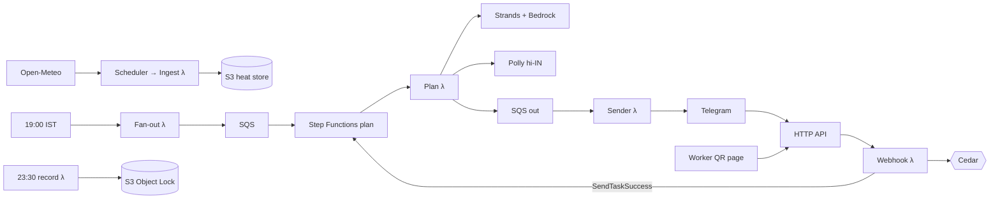

# Invisible Heat

**Heat-safety work-rest plans for India's outdoor workers, built on WBGT, delivered in Hindi on Telegram.**

Environmental Hacks (Bharat Builds Tour, Event 02) · WeMakeDevs × AWS · Track 02: Heat and Water · Team Mavricks

> India's heatwave alerts that trigger action use temperature, not humidity. But workers are harmed by heat and humidity together. Invisible Heat turns the forecast into an hour-by-hour work-rest plan for each site, sends it as a Hindi voice note, lets workers log rest and symptoms with no app, keeps a tamper-proof record, and audits how many dangerous days the official rule never flagged.

## The problem

A humid 36 °C day can be harder on a construction worker than a dry 42 °C day, yet only the second can trigger an official heatwave. The heat-stress measure used by OSHA, NIOSH and many armies is **WBGT** (Wet Bulb Globe Temperature), which combines temperature, humidity, sun and wind. Site supervisors in India don't get a WBGT-based plan, so on many dangerous days nobody changes work hours.

**Kharghar, Navi Mumbai, 16 April 2023.** People died of heatstroke at an open-air event; there was no official heatwave warning that day. Our replay on ERA5 reanalysis shows why:

| | |
|---|---|
| Daily max temperature (ERA5) | 38.8 °C, +3.5 °C above the 1991–2020 normal |
| Recreated IMD heatwave rule | **No heatwave** |
| WBGT in the sun at noon | **30.8 °C**, above the 28.2 °C NIOSH limit for moderate work |
| Plan the app would have sent | Stop work 11:00–14:00, 30–45 min rest per hour around it |

`uv run python scripts/kharghar_replay.py` · details in [`docs/results/KHARGHAR.md`](docs/results/KHARGHAR.md)

**The audit.** Across 10 cities from 2021 to 2025, there were **3,459 city-days** when WBGT in the *shade* crossed the NIOSH moderate-work limit with no heatwave under the recreated IMD rule (96% of all such days). **1,679** of them fell outside March–June, when heatwave bulletins don't run. These are minimums, because ERA5 smooths humid extremes. See [`docs/results/audit_summary.json`](docs/results/audit_summary.json).

## What it does

| Part | For whom | What it does |
|---|---|---|
| **Plan it** | Site supervisor | At 19:00 IST a Hindi text plus a Polly voice note: stop-work window, rest minutes per hour, water cans, a reduced schedule for new workers, and which forecast it is based on. **Approve / Override** buttons. |
| **Re-check** | Site supervisor | At 10:30 and 13:30 the plan is rebuilt from the newest forecast. An alert goes out only if any remaining hour got stricter, and it must be acknowledged. |
| **Ask** | Site supervisor | Text or voice: "Kya hum 2 baje concrete daal sakte hain?" The Strands agent answers from tool results only; tools find the coolest 4-hour window. |
| **Crew by voice** | Site supervisor | "40 log, 10 bhaari kaam, 3 naye aaye" → Transcribe (hi-IN) → rule-based parse → read back → confirm before saving. |
| **Worker QR page** | Workers | No app, no account: tap **Aaram shuru / khatam** to log a break, or **Chakkar aa raha hai** for fixed first-aid text, which also alerts the supervisor. |
| **Picture poster** | Workers | A printable "day ruler": each hour is a column, filled green for the share of the hour that is rest, red with a hand for stop-work. Readable without reading Hindi. |
| **Prove it** | Contractor / auditor | A nightly SHA-256 hash-chained record per site in S3 Object Lock, and a monthly compliance PDF built only from those records. |
| **See it** | Public | The Invisible Heat Audit page and a model card. |

| Poster | Worker page | Audit |
|---|---|---|
|  |  |  |

## How the AI is kept honest

1. **Numbers come from code, never from the model.** `heatcore/` is pure Python with no AWS imports. Every user-facing number comes from it.
2. **Number check.** Every number in an AI reply must appear in a tool output from the same turn (`agent/number_check.py`). If it doesn't, the reply is regenerated once; if it still fails, the fixed template is sent.
3. **Plan messages:** a short AI intro sits on top of a fixed template body, so stop times, rest minutes and water never depend on the model.
4. **The AI can never loosen a plan.** This is enforced by Cedar (`cedar/policies/plans.cedar`), not by the prompt. Only the site's supervisor can loosen a plan, and only with a written reason of at least 10 characters.
5. **First aid is fixed text.** Symptom messages are routed to it before any model call.
6. **Fallback always exists.** If Bedrock fails, the plan goes out as fixed Hindi text; if Polly fails, as text only.

## Architecture

Everything runs in one SAM stack in `ap-south-1` and is serverless. The full diagram, a service-by-service rationale and the failure-mode table are in [`docs/architecture.md`](docs/architecture.md).



**AWS services:** Lambda (arm64/Graviton), API Gateway HTTP API, Step Functions, EventBridge Scheduler, SQS, DynamoDB, S3 (+ Object Lock), Amazon Bedrock, Amazon Polly, Amazon Transcribe, SSM Parameter Store, CloudWatch, SNS and Budgets.
**AWS open source:** Strands Agents SDK, Cedar (via `cedarpy`), SAM CLI.

## Run it

```bash
uv sync --python 3.12          # Python 3.12, uv
uv run pytest                  # 149 tests: science, Cedar, agent tools, webhook, check-ins, e2e
uv run python scripts/kharghar_replay.py
uv run python scripts/run_audit.py              # ~1 min with cache; writes docs/results/audit_summary.json
uv run python scripts/seed_sample_month.py && uv run python scripts/verify_hash_chain.py --dir out/sample_records
```

### Deploy (AWS SAM, ap-south-1)

```bash
TELEGRAM_TOKEN=<from @BotFather> ./scripts/setup_secrets.sh   # SSM SecureString, never in git
make layer && sam build && sam deploy                          # samconfig.toml targets ap-south-1
uv run python scripts/set_webhook.py                           # points the bot at the API
```

Then open the bot and send `/start`, then `/register Ramesh Tower, Chennai`, `/crew 40 10 3` and `/plan_now`. Optional: `sam deploy --parameter-overrides AlertEmail=you@example.com` adds a $5 budget alert and alarm emails.

Re-check demo (clearly labelled **SIMULATED** in the message): `aws lambda invoke --function-name <RecheckFunctionName> --payload '{"simulate_delta_c": 1.5}' out.json`.

## Results

| Check | Result |
|---|---|
| WBGT vs OSHA online calculator, 15 Chennai hours | Mean absolute difference **0.21 °C**, max 0.49 °C (OSHA output to 1 °F). `tests/test_heatcore_wbgt.py` |
| NIOSH limits | REL 28.2 °C, RAL 25.0 °C at 300 W, matching the worked example |
| Cedar decisions | All 7 required cases plus 5 more pass; the AI is denied LoosenPlan and OverridePlan |
| Agent test set (20 questions, `tests/agent_questions.jsonl`) | **Pending.** Bedrock access was still under account verification when this was written. Run `uv run python scripts/eval_agent.py --out docs/results/agent_eval.json` to get it. We will publish the numbers as measured. |
| Audit 2021–2025, 10 cities | 3,459 invisible heat city-days (shade), 1,679 outside March–June (a minimum) |

## Limits (read before quoting anything)

- The weather grid is 11–25 km wide, so a site-level plan rests on district-scale weather. Tin roofs, concrete and lack of shade make real sites hotter.
- There is no open Indian heat-illness outcome data, so **we make no claim of lives saved**. The design aim is to reduce exposure.
- The IMD heatwave rule is **recreated** on one ERA5 grid cell per city. It is not IMD's official declaration record, and its "2 or more stations" condition is approximated.
- ERA5 smooths extremes, so audit counts are a **minimum**.
- The rest-minute bands (15/30/45/stop by each 1 °C above the limit) are **this project's own planning rule** inspired by NIOSH guidance, not a quoted standard. ACGIH tables are not used.
- One deterministic forecast, no ensemble, so plans never state probabilities. A fixed +1.0 °C margin is used (+0.5 °C if the forecast is stale).
- Open-Meteo's free API is for non-commercial use.
- The first-aid page is fixed text, not medical advice or a diagnosis.
- **Simulated or sample:** the re-check demo forecast (labelled SIMULATED), the sample compliance month (labelled SAMPLE DATA), and the "Ramesh" story.

## Privacy

Headcounts only, never worker names, phone numbers or IDs. Supervisor chat IDs are AES-GCM encrypted, looked up by HMAC, and never logged. Worker devices are random anonymous tokens stored as keyed hashes; check-ins expire after 90 days. All data stays in `ap-south-1`. `/delete_my_data` removes a site's data; Object-Locked daily records expire at the end of retention. Cedar keeps raw check-ins visible only to the site's supervisor. This is DPDP-aware design, not legal advice.

## Closest existing tool: SHRAM

SHRAM (UC Berkeley IECC, 2026) sends district-level heat-stress forecasts by email. Credit to that team. *SHRAM tells a district how hot it will be; we tell a site supervisor what to do hour by hour, and keep a record that it was done.*

## What's next (roadmap, not built)

WhatsApp delivery (needs paid utility templates for scheduled pushes), red-day escalation to contractors, a weekly outlook, many sites per contractor, Tamil/Bengali/Odia voices, ECMWF ensembles for probabilities, a labour-department aggregate view, an insurance-trigger API, and site sensor correction.

## Credits and licences

- WBGT: [thermofeel](https://github.com/ecmwf/thermofeel) (ECMWF, Apache-2.0), Liljegren et al. 2008.
- Limits and acclimatisation: NIOSH Criteria for a Recommended Standard, Occupational Exposure to Heat and Hot Environments (2016-106), public domain.
- Weather: Open-Meteo forecast and archive APIs; ERA5 (Copernicus/ECMWF, CC BY 4.0).
- Validation: OSHA Outdoor WBGT Calculator.
- Guidance passages: NIOSH/CDC, NDMA heat-wave guidelines (2019), OSHA, IMD.
- Code licence: see [LICENSE](LICENSE).

## AI tools used

As the hackathon rules require:

- **Claude Code** (Anthropic, Claude Opus 5.5): planned the phases and wrote most of the code, tests and docs in this repo, under the team's direction and review.
- **Claude on Amazon Bedrock** (via Strands Agents, India inference profiles): runtime explanations and Q&A inside the product, behind the number check and Cedar.
- Amazon Polly and Amazon Transcribe for voice in and out.

## Team

Mavricks: Arpit Singh (lead), Pradyuman Sharma.
