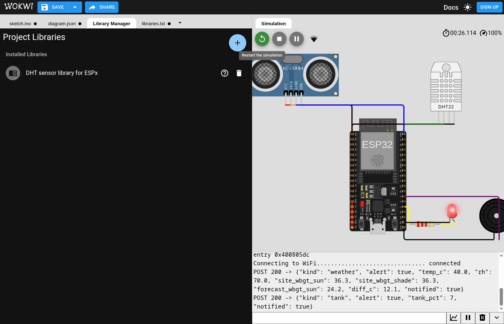
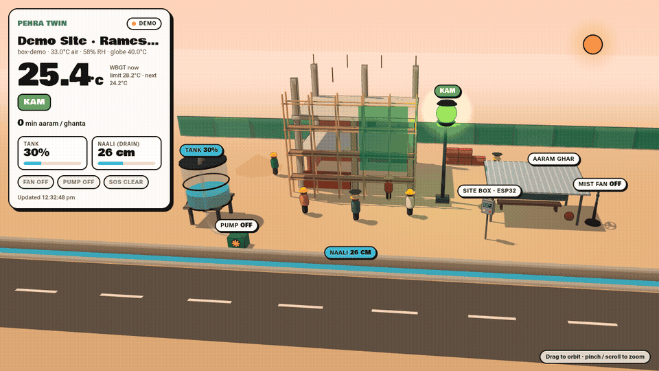
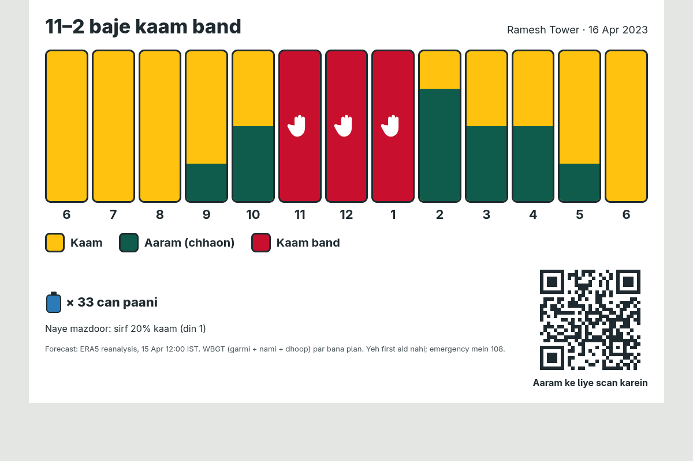
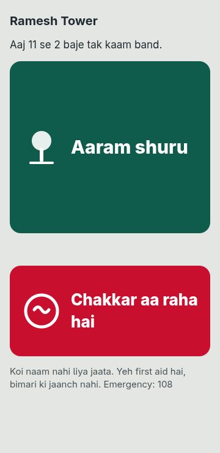
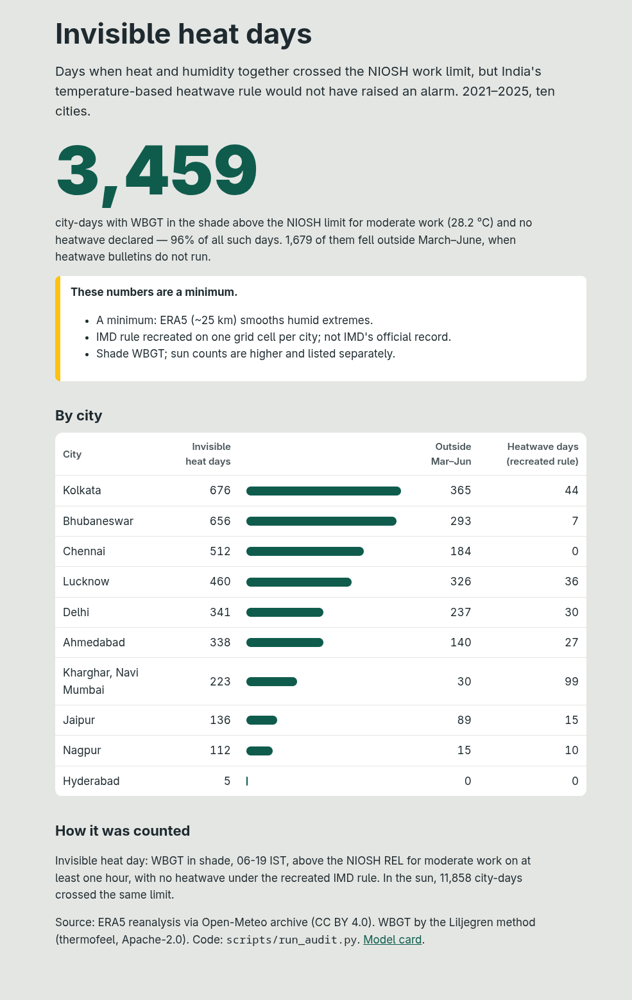
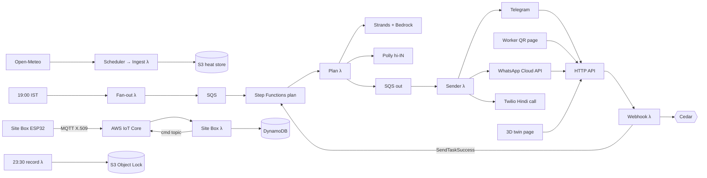

# Pehra (पहरा)

**Heat and water safety for India's outdoor workers and their families: WBGT-based plans, rain, flood and warm-night alerts, a drinking-water finder and site sensors, in Hindi on WhatsApp (and Telegram), with Hindi phone-call alerts, and a ₹600 Site Box on AWS IoT Core with a live 3D twin.**

Environmental Hacks (Bharat Builds Tour, Event 02) · WeMakeDevs × AWS · Track 02: Heat and Water · Team Mavricks

> India's heatwave alerts that trigger action use temperature, not humidity. But workers are harmed by heat and humidity together. Invisible Heat turns the forecast into an hour-by-hour work-rest plan for each site, sends it as a Hindi voice note, lets workers log rest and symptoms with no app, keeps a tamper-proof record, and audits how many dangerous days the official rule never flagged.

## The problem

A humid 36 °C day can be harder on a construction worker than a dry 42 °C day, yet only the second can trigger an official heatwave. The heat-stress measure used by OSHA, NIOSH and many armies is **WBGT** (Wet Bulb Globe Temperature), which combines temperature, humidity, sun and wind. Site supervisors in India don't get a WBGT-based plan, so on many dangerous days nobody changes work hours.

**Kharghar, Navi Mumbai, 16 April 2023.** People died of heatstroke at an open-air event; there was no official heatwave warning that day. Our replay on ERA5 reanalysis shows why:

| | |
|---|---|
| Daily max temperature (ERA5) | 38.8 °C, +3.5 °C above the 1991–2020 normal |
| Recreated IMD heatwave rule | **No heatwave** |
| WBGT in the sun at noon | **30.8 °C**, above the 28.2 °C NIOSH limit for moderate work |
| Plan the app would have sent | Stop work 11:00–14:00, 30–45 min rest per hour around it |

`uv run python scripts/kharghar_replay.py` · details in [`docs/results/KHARGHAR.md`](docs/results/KHARGHAR.md)

**The audit (12 cities, 2021–2025).** **4,372 city-days** when WBGT in the *shade* crossed the NIOSH moderate-work limit with no heatwave under the recreated IMD rule. **2,327** of them fell outside March–June, when heatwave bulletins don't run. The same period held **90 heavy-rain days** (≥ 64.5 mm) and **68 warm nights** (IMD rule recreated). These are minimums, because ERA5 smooths extremes. See [`docs/results/audit_summary.json`](docs/results/audit_summary.json).

## What it does

| Part | For whom | What it does |
|---|---|---|
| **Plan it** | Site supervisor | At 19:00 IST a Hindi text plus a Polly voice note: stop-work window, rest minutes per hour, water cans, a reduced schedule for new workers, and which forecast it is based on. **Approve / Override** buttons. |
| **Re-check** | Site supervisor | At 10:30 and 13:30 the plan is rebuilt from the newest forecast. An alert goes out only if any remaining hour got stricter, and it must be acknowledged. |
| **Ask** | Site supervisor | Text or voice: "Kya hum 2 baje concrete daal sakte hain?" The Strands agent answers from tool results only; tools find the coolest 4-hour window. |
| **Crew by voice** | Site supervisor | "40 log, 10 bhaari kaam, 3 naye aaye" → Transcribe (hi-IN) → rule-based parse → read back → confirm before saving. |
| **WhatsApp too** | Site supervisor | The same bot on the WhatsApp Cloud API (free test number for the demo), with buttons and voice notes. See [`docs/WHATSAPP_AND_CALLS.md`](docs/WHATSAPP_AND_CALLS.md). |
| **Hindi phone call** | Site supervisor | Opt in with `/call_on`. A worker's "chakkar" report or a stop-work re-check also rings the supervisor's phone with a fixed Hindi message (Polly voice, Twilio; free trial for the demo). |
| **Worker QR page** | Workers | No app, no account: tap **Aaram shuru / khatam** to log a break, or **Chakkar aa raha hai** for fixed first-aid text, which also alerts the supervisor. |
| **Picture poster** | Workers | A printable "day ruler": each hour is a column, filled green for the share of the hour that is rest, red with a hand for stop-work. Readable without reading Hindi. |
| **Prove it** | Contractor / auditor | A nightly SHA-256 hash-chained record per site in S3 Object Lock, and a monthly compliance PDF built only from those records. |
| **See it** | Public | The Invisible Heat Audit page and a model card. |

### For everyone, and for water (v2)

Track 02 is *"too much water, too little of it, and the heat in between"*. v2 extends the same engine (plan: [`docs/PLAN_V2.md`](docs/PLAN_V2.md)):

| Feature | Who | What it does |
|---|---|---|
| **Garmi Saathi (personal and family mode)** | Anyone | `/start`, then *Mere aur parivar ke liye*. Send a city or share a 📍 location (any place in India: a 0.25° tile computed once and shared), answer 5 button questions about the household (counts only), and get a 07:00 message: the level for healthy adults and for vulnerable members (elderly, under-5s, pregnant, chronic illness, outdoor workers), hours to avoid, better hours for errands, and night, rain and flood lines. `/aaj` on demand. |
| **Family call ("Dadi ko call")** | Elderly people | `/family_call +91…`: on *bahut zyada* or *khatarnak* days, one fixed Hindi phone call a day to an elderly relative (Twilio). |
| **Paani aur chhaon** | Vendors, riders, everyone | Share a location, or type a landmark (`paani Connaught Place`), and get the 3 nearest drinking-water and shade points from OpenStreetMap, cached per city. `/add_paani` adds community points, shown after 2 independent reports and labelled unverified. |
| **Heavy rain and waterlogging** | Sites, everyone | IMD rainfall categories on the forecast. Sites get "stop digging, scaffolding, electrical work". |
| **River-flood signal** | Guwahati (Brahmaputra), Patna (Ganga) | GloFAS discharge against the point's own 1991–2020 95th and 99th percentiles. |
| **Warm nights** | Labour camps, families | IMD warm-night rule recreated with ERA5 normals; sleep and labour-camp advice. |
| **More user types** | Schools, vendors, delivery riders | `/register`, then pick the type; each gets its own limits (schoolchildren against RAL) and fixed lines. |
| **Site sensors (ESP32)** | Sites, households | `/device weather`, `/device tank 120` or `/device drain 100`. The DHT22 reading becomes a site-corrected WBGT ("site 12 °C hotter than forecast"); the HC-SR04 gives a low-tank or waterlogging alert, with a call for drains. Runs on real hardware, free in **Wokwi**, or in our web simulator. See [`devices/README.md`](devices/README.md). |

### Pehra Site Box: ESP32 + AWS IoT Core + live 3D twin

For sites where nobody has a smartphone, one box per site does the job of the bot. It measures the heat workers actually feel and the site's water, and the server tells it what to do. It runs on real hardware (about ₹600 of parts) or free in the **Wokwi** simulator, with the same firmware: [`devices/sitebox/`](devices/sitebox/).

| Part | What it does on site |
|---|---|
| DHT22 + DS18B20 in a matt-black ball (globe) | Air temperature, humidity and radiant heat → **measured site WBGT** = 0.7 Tnw + 0.2 Tg + 0.1 Ta, compared with the forecast ("site 3 °C hotter than forecast" alert) |
| 2 × HC-SR04 | Drinking-water tank level (pump refill, "tank low" alert with cans needed) and drain/road water level (waterlogging alert + call) |
| SSD1306 OLED + 12-LED ring | Four Hindi status lines and the risk colour (kam → khatarnak) |
| Buzzer | Rest siren at the start of each rest block, a stop-work siren during stop hours |
| 2 relays | Mist fan on from *zyada*; tank pump with hysteresis (on below 20 %, off at 90 %) |
| Red SOS button | Immediate report: WhatsApp alert and a Hindi phone call to the supervisor |

**How it talks to AWS.** The box publishes telemetry over MQTT/TLS with its own X.509 certificate to **AWS IoT Core** (`pehra/box/{thing}/telemetry`; the IoT policy only lets a thing publish to its own topic). An IoT rule (`SELECT *, topic(3) AS box_id`) invokes the Site Box Lambda, which computes WBGT and the level (`heatcore/sitebox.py`) with the same 1 °C rest bands as the plans, sends rate-limited alerts, stores the state in DynamoDB and publishes the command back on `pehra/box/{thing}/cmd`. HTTPS `POST /api/box` with a device token is the fallback (used in Wokwi when TLS is not set up). `scripts/iot_provision.py` creates the thing, certificate and policy and writes a filled-in sketch. Contract: [`docs/SITEBOX_CONTRACT.md`](docs/SITEBOX_CONTRACT.md).

**Live 3D twin.** Every box gets a private page, `/twin/{view_token}` (Three.js), that polls the box state every 3 s: the site, workers resting under the shade when `aaram_now`, the fan and pump running, the tank and drain levels and the risk colour. `?demo=1` cycles through the levels without a box.

| Wokwi ESP32 (real firmware, live API) | Live 3D twin |
|---|---|
|  |  |

| Poster | Worker page | Audit |
|---|---|---|
|  |  |  |

## How the AI is kept honest

1. **Numbers come from code, never from the model.** `heatcore/` is pure Python with no AWS imports. Every user-facing number comes from it.
2. **Number check.** Every number in an AI reply must appear in a tool output from the same turn (`agent/number_check.py`). If it doesn't, the reply is regenerated once; if it still fails, the fixed template is sent.
3. **Plan messages:** a short AI intro sits on top of a fixed template body, so stop times, rest minutes and water never depend on the model.
4. **The AI can never loosen a plan.** This is enforced by Cedar (`cedar/policies/plans.cedar`), not by the prompt. Only the site's supervisor can loosen a plan, and only with a written reason of at least 10 characters.
5. **First aid is fixed text.** Symptom messages are routed to it before any model call.
6. **Fallback always exists.** If Bedrock fails, the plan goes out as fixed Hindi text; if Polly fails, as text only.

## Architecture

Everything runs in one SAM stack in `ap-south-1` and is serverless. The full diagram, a service-by-service rationale and the failure-mode table are in [`docs/architecture.md`](docs/architecture.md).



**Outside AWS (demo tiers):** Telegram Bot API (free), WhatsApp Cloud API test number (free, up to 5 recipients), Twilio trial for voice calls.

**AWS services:** Lambda (arm64/Graviton), API Gateway HTTP API, Step Functions, EventBridge Scheduler, SQS, DynamoDB, S3 (+ Object Lock), AWS IoT Core, Amazon Bedrock, Amazon Polly, Amazon Transcribe, SSM Parameter Store, CloudWatch, SNS and Budgets.
**AWS open source:** Strands Agents SDK, Cedar (via `cedarpy`), SAM CLI.

## Run it

```bash
uv sync --python 3.12          # Python 3.12, uv
uv run pytest                  # 245 tests: science, Cedar, agent tools, webhooks, Site Box, e2e
uv run python scripts/kharghar_replay.py
uv run python scripts/run_audit.py              # ~1 min with cache; writes docs/results/audit_summary.json
uv run python scripts/seed_sample_month.py && uv run python scripts/verify_hash_chain.py --dir out/sample_records
```

### Deploy (AWS SAM, ap-south-1)

```bash
TELEGRAM_TOKEN=<from @BotFather> ./scripts/setup_secrets.sh   # SSM SecureString, never in git
make layer && sam build && sam deploy                          # samconfig.toml targets ap-south-1
uv run python scripts/set_webhook.py                           # points the bot at the API
```

Live bot: **Telegram [@Pehra_AWS_bot](https://t.me/Pehra_AWS_bot)** · WhatsApp test number +1 555-648-9580 (Meta test number: only pre-approved recipients) · Hindi call alerts from a Twilio trial number.

Live stack: `https://yj61i9i7g0.execute-api.ap-south-1.amazonaws.com` ([/audit](https://yj61i9i7g0.execute-api.ap-south-1.amazonaws.com/audit), [/model-card](https://yj61i9i7g0.execute-api.ap-south-1.amazonaws.com/model-card)). Smoke test without sending any message: `uv run python scripts/smoke_deployed.py`.

Then message the WhatsApp number (or the Telegram bot) with `hi`, then `/register Ramesh Tower, Chennai`, `40 log, 10 bhaari kaam, 3 naye aaye` and `plan`. A city outside the 12 pre-computed ones snaps to the nearest one within 60 km (Mumbai → Kharghar). Optional: `sam deploy --parameter-overrides AlertEmail=you@example.com` adds a $5 budget alert and alarm emails.

Re-check demo (clearly labelled **SIMULATED** in the message): `aws lambda invoke --function-name <RecheckFunctionName> --payload '{"simulate_delta_c": 1.5}' out.json`.

## Results

| Check | Result |
|---|---|
| WBGT vs OSHA online calculator, 15 Chennai hours | Mean absolute difference **0.21 °C**, max 0.49 °C (OSHA output to 1 °F). `tests/test_heatcore_wbgt.py` |
| NIOSH limits | REL 28.2 °C, RAL 25.0 °C at 300 W, matching the worked example |
| Cedar decisions | All 7 required cases plus 5 more pass; the AI is denied LoosenPlan and OverridePlan |
| Agent test set (40 Hindi/English questions, Amazon Nova Pro) | Latest run: facts correct **38/40** · invented numbers shipped **0** · correct refusals **9/9** · 4 fixed-text fallbacks. Earlier 20-question runs: 19/20 twice. Misses are logged with the raw answers in `docs/results/agent_eval_40.json`. A unit-aware number check now also stops wrong can and litre counts. |
| v2 live smoke test (`scripts/smoke_v2.py`) | Personal forecast for Delhi and an on-demand Varanasi tile; water finder found 3 points within 350 m of Connaught Place; 07:00 fan-out Lambda sent 2; weather and drain sensors alerted through the live API |
| ESP32 in Wokwi (`devices/wokwi/`) | Simulated DHT22 at 40 °C / 70% → site WBGT 36.3 °C vs forecast 24.2 °C → alert and red LED; HC-SR04 → tank 7% → alert |
| Deployed smoke test (`scripts/smoke_deployed.py`) | Plan built by the live plan Lambda with AI intro and Polly voice note; worker page, poster and audit served; break logged; nightly record written in Object Lock (GOVERNANCE, 90 days); hash chain verified |
| Audit 2021–2025, 12 cities | 4,372 invisible heat city-days (shade), 2,327 outside March–June, 90 heavy-rain days, 68 warm nights (minimums) |
| Real phone, end to end (11 Oct 2026, moto g34, WhatsApp test number + Twilio trial) | Family mode: 5 button questions → today's Mumbai plan (khatarnak) · `paani Connaught Place` → water 190 m away · site registered in Kharghar, crew typed in Hindi, `plan` → text + 16 s Hindi voice note → Approve saved · worker QR page: rest logged, "chakkar" → supervisor alert + Hindi call · test call · AI question answered from tools · family call to an elder on a khatarnak day · `/device box` → IoT Core readings → tank-low and hotter-than-forecast alerts → live twin on the phone → SOS → WhatsApp alert + Hindi call · Override with a written reason (Cedar). Every call played the full Hindi message (Twilio durations match the audio). |
| Site Box through AWS IoT Core (live) | MQTT publish → IoT rule → Site Box Lambda → state in DynamoDB → command published on the box's `cmd` topic; the twin page shows the same state |

## Demo video

A brand video built in **Remotion** (`video/`): Inter and Noto Sans Devanagari, the website's palette with one saffron accent, spring motion with a tiny overshoot, no glows or crossfades. The story runs in order: the problem told fully (thermometer vs the body, WBGT, Kharghar 16 April 2023, the audit on the live site with the facts highlighted, the water side), then Pehra as four complete stories on a real phone (supervisor, worker, family, vendor), then the Site Box (what each part measures, what it acts on, the Wokwi run, AWS IoT Core, the live 3D twin, SOS), then an animated hand-drawn architecture, then what Pehra does not claim.

- Narration: Amazon Polly (Kajal), `scripts/video/vo.py`; every number comes from `docs/results/` and the audit page.
- Illustrations: generated with Codex in the brand style (`video/public/gen/`). Illustrated people, not real people.
- Phone chapters: one scrcpy recording cut per feature by `scripts/video/phone_cut.py` (owner's number blurred, waits sped up and labelled, each call's audio is the Polly MP3 the call played). Tokens seen on screen were rotated with `scripts/rotate_tokens.py`.
- Twin footage: `scripts/video/record_twin.mjs` records the live `/twin/{view}` page.

```bash
uv run python scripts/video/vo.py                      # narration + word marks → video/public/vo
uv run python scripts/video/phone_cut.py               # phone chapters → out/video/phone (linked into video/public)
node scripts/video/record_twin.mjs <twin url> out/video/twin.mp4
cd video && npm install && npx remotion render src/index.ts Pehra out/pehra_brand.mp4
```

Script and shot list: [`docs/VIDEO_SCRIPT.md`](docs/VIDEO_SCRIPT.md).

## Limits (read before quoting anything)

- The weather grid is 11–25 km wide, so a site-level plan rests on district-scale weather. Tin roofs, concrete and lack of shade make real sites hotter.
- There is no open Indian heat-illness outcome data, so **we make no claim of lives saved**. The design aim is to reduce exposure.
- The IMD heatwave rule is **recreated** on one ERA5 grid cell per city. It is not IMD's official declaration record, and its "2 or more stations" condition is approximated.
- ERA5 smooths extremes, so audit counts are a **minimum**.
- The rest-minute bands (15/30/45/stop by each 1 °C above the limit) are **this project's own planning rule** inspired by NIOSH guidance, not a quoted standard. ACGIH tables are not used.
- The deployed agent uses Amazon Nova through the `apac.` inference profile, so model requests may be served from other Asia-Pacific regions. Stored data stays in `ap-south-1`. Claude via the India-only `in.` profiles keeps model processing in India once Marketplace access is enabled on the account.
- One deterministic forecast, no ensemble, so plans never state probabilities. A fixed +1.0 °C margin is used (+0.5 °C if the forecast is stale).
- Open-Meteo's free API is for non-commercial use.
- The first-aid page is fixed text, not medical advice or a diagnosis.
- Personal risk levels are our own rule on NIOSH light-activity limits, not a medical assessment. Rain categories, warm nights and flood signals are computed from forecasts and reanalysis; they are not IMD or CWC warnings.
- OpenStreetMap water and shade coverage is patchy (7 points near Kharghar, 658 near Delhi). Community points are unverified.
- A DHT22 sensor corrects air temperature and humidity only; wind and sun still come from the forecast.
- **Simulated or sample:** the re-check demo forecast (labelled SIMULATED), the sample compliance month (labelled SAMPLE DATA), and the "Ramesh" story.

## Privacy

Headcounts only, never worker names, phone numbers or IDs. Supervisor chat IDs are AES-GCM encrypted, looked up by HMAC, and never logged. Worker devices are random anonymous tokens stored as keyed hashes; check-ins expire after 90 days. All data stays in `ap-south-1`. `/delete_my_data` removes a site's data; Object-Locked daily records expire at the end of retention. Cedar keeps raw check-ins visible only to the site's supervisor. This is DPDP-aware design, not legal advice.

## Closest existing tool: SHRAM

SHRAM (UC Berkeley IECC, 2026) sends district-level heat-stress forecasts by email. Credit to that team. *SHRAM tells a district how hot it will be; we tell a site supervisor what to do hour by hour, and keep a record that it was done.*

## What's next (roadmap, not built)

WhatsApp scheduled pushes (need paid utility templates), production voice calls with an Indian caller ID, red-day escalation to contractors, a weekly outlook, many sites per contractor, Tamil/Bengali/Odia voices, ECMWF ensembles for probabilities, a labour-department aggregate view, an insurance-trigger API, and site sensor correction.

## Credits and licences

- WBGT: [thermofeel](https://github.com/ecmwf/thermofeel) (ECMWF, Apache-2.0), Liljegren et al. 2008.
- Limits and acclimatisation: NIOSH Criteria for a Recommended Standard, Occupational Exposure to Heat and Hot Environments (2016-106), public domain.
- Weather: Open-Meteo forecast, archive, flood (GloFAS) and geocoding APIs; ERA5 (Copernicus/ECMWF, CC BY 4.0).
- Water and shade points: © OpenStreetMap contributors (ODbL). Device simulator: Wokwi.
- Validation: OSHA Outdoor WBGT Calculator.
- Guidance passages: NIOSH/CDC, NDMA heat-wave guidelines (2019), OSHA, IMD.
- Code licence: see [LICENSE](LICENSE).

## AI tools used

As the hackathon rules require:

- **Claude Code** (Anthropic, Claude Opus 5.5): planned the phases and wrote most of the code, tests and docs in this repo, under the team's direction and review.
- **Amazon Nova Pro on Amazon Bedrock** (via Strands Agents): runtime explanations and Q&A inside the product, behind the number check and Cedar. Claude via the India (`in.`) inference profiles is supported by changing two stack parameters.
- Amazon Polly and Amazon Transcribe for voice in and out.

## Team

Mavricks: Arpit Singh (lead), Pradyuman Sharma.
