<p align="center">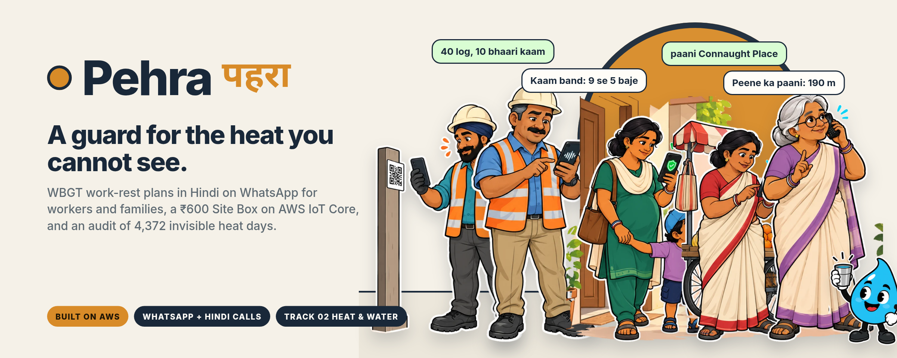</p>

<p align="center">
  <a href="https://yj61i9i7g0.execute-api.ap-south-1.amazonaws.com/"><b>Website</b></a> ·
  <a href="https://wa.me/15556489580?text=hi"><b>WhatsApp</b></a> ·
  <a href="https://yj61i9i7g0.execute-api.ap-south-1.amazonaws.com/twin/view_SvbNnihTsWfcju52eyfKZA?demo=1"><b>Live 3D twin</b></a> ·
  <a href="https://yj61i9i7g0.execute-api.ap-south-1.amazonaws.com/audit"><b>Audit</b></a> ·
  <a href="https://yj61i9i7g0.execute-api.ap-south-1.amazonaws.com/model-card"><b>Model card</b></a> ·
  <a href="https://t.me/Pehra_AWS_bot"><b>Telegram</b></a> ·
  <a href="docs/BRAND.md"><b>Brand kit</b></a>
</p>

<p align="center">Environmental Hacks (Bharat Builds Tour, Event 02) · WeMakeDevs × AWS · Track 02: Heat and Water · Team Mavricks</p>

<p align="center"><a href="https://yj61i9i7g0.execute-api.ap-south-1.amazonaws.com/">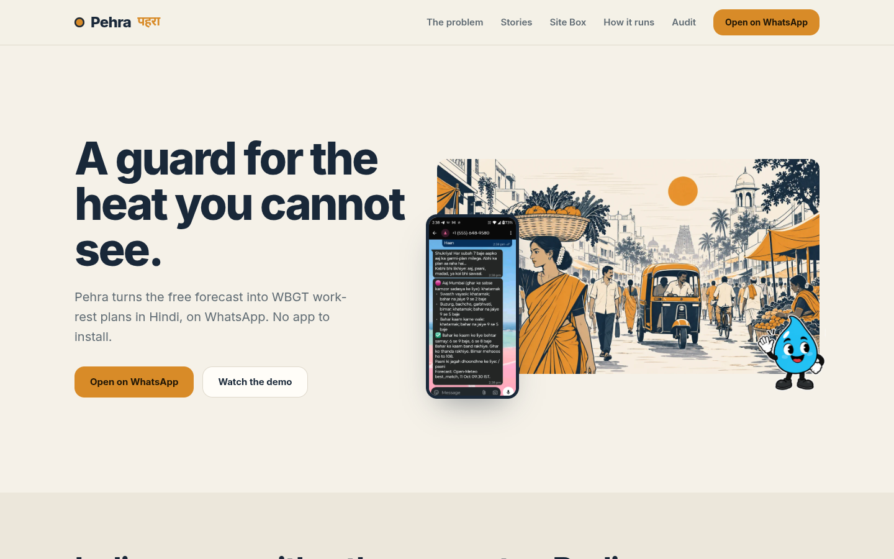</a><br><sub>The live website, with the 3D twin playing inline. <a href="docs/img/site-full.png">Full page</a>.</sub></p>

**Pehra** (पहरा, "guard") turns the free weather forecast into WBGT work-rest plans for India's outdoor workers and families, in Hindi, on WhatsApp, with Hindi phone calls for alerts. For sites with no smartphone there is a ₹600 **Site Box** on AWS IoT Core with a live 3D twin. Everything runs as one serverless stack in Mumbai, and every number comes from code, never from the model.

> Demo video: `video/` (Remotion, about 12 minutes). Script: [`docs/VIDEO_SCRIPT.md`](docs/VIDEO_SCRIPT.md). The WhatsApp part is a real phone recording from 11 October 2026.

---

## 1. The problem

<table><tr>
<td width="55%" valign="top">

India warns its people with a thermometer. The body cools by sweating; on a humid day sweat does not dry and the cooling stops, so a humid 36 °C day can hurt a worker more than a dry 42 °C day. Safety scientists measure this with **WBGT** (Wet Bulb Globe Temperature: temperature, humidity, sun and wind in one number). It is what NIOSH, OSHA and many armies use to decide when work must stop. India's public heat alerts still use temperature alone.

**Kharghar, Navi Mumbai, 16 April 2023.** People died of heatstroke at an open-air event. The maximum temperature was 38.8 °C: under the official rule, not a heatwave, so no alert. Our replay on ERA5 reanalysis shows WBGT in the sun above the 28.2 °C work limit from 10:00 to 16:00, peaking at 30.8 °C at noon. Real, and invisible.

`uv run python scripts/kharghar_replay.py` · [`docs/results/KHARGHAR.md`](docs/results/KHARGHAR.md)

</td>
<td width="45%"></td>
</tr></table>

**The audit.** 12 cities, 2021 to 2025: **4,372 city-days** crossed the WBGT work limit in the shade while no heatwave was declared (97% of all such days). **2,327** of them fell outside March to June, when heatwave bulletins do not run. The same years held **90 heavy-rain days** and **68 warm nights**. These are minimums: ERA5 (~25 km) smooths humid extremes. Live page: [audit](https://yj61i9i7g0.execute-api.ap-south-1.amazonaws.com/audit) · data: [`docs/results/audit_summary.json`](docs/results/audit_summary.json).

### Where every number comes from

Each number on the website is produced by a script in this repo from public reanalysis data, and the page states its source and caveats. The saffron boxes mark the number; the legend names the file it comes from.

<p align="center">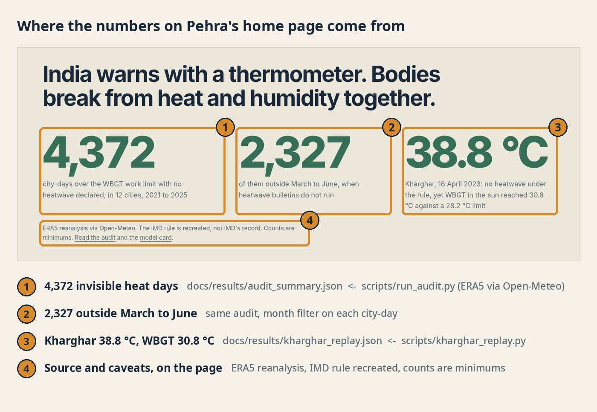</p>

<table><tr>
<td width="52%">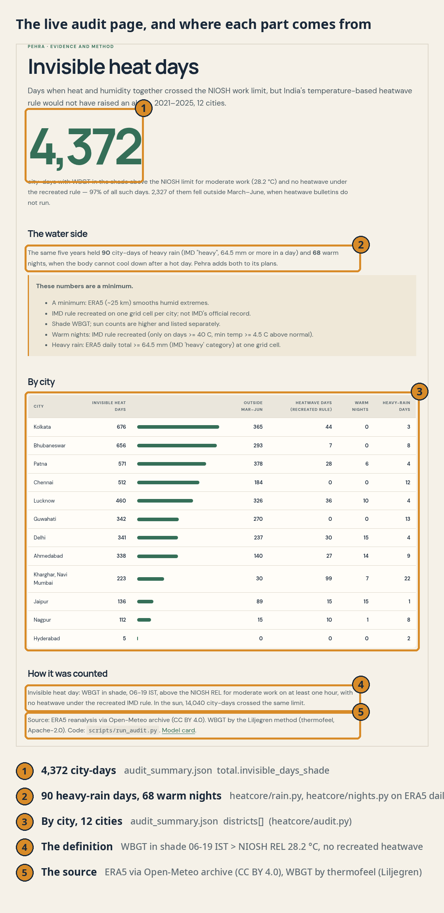</td>
<td width="48%" valign="top">

**The pipeline behind the audit**

1. `scripts/run_audit.py` downloads hourly ERA5 reanalysis for 12 cities, 2021 to 2025, from the Open-Meteo archive (cached in `out/audit/`).
2. `heatcore/wbgt.py` computes WBGT in sun and shade with the Liljegren method (thermofeel), checked against OSHA's calculator to 0.21 °C.
3. `heatcore/imd_rule.py` recreates the IMD heatwave rule on the same grid cell, against a 1991 to 2020 ERA5 normal.
4. `heatcore/audit.py` counts a city-day when shade WBGT, 06 to 19 IST, crosses the NIOSH REL (28.2 °C, moderate work) and the rule declares no heatwave. Rain and warm nights come from `heatcore/rain.py` and `heatcore/nights.py`.
5. The result is `docs/results/audit_summary.json`; `scripts/build_pages.py` renders the audit page and the home page numbers from it, so the site can never drift from the data.

The Kharghar numbers come from `scripts/kharghar_replay.py` → `docs/results/kharghar_replay.json` (ERA5 for 16 April 2023, grid cell 19.02 N 73.05 E).

</td></tr></table>

---

## 2. Pehra on WhatsApp, as four stories

Recorded on a real phone (moto g34, Android 15) with the WhatsApp Cloud API test number and a Twilio trial call. The people below are illustrated; the messages are real.

<table>
<tr>
<td width="20%" align="center"><br><b>Ramesh</b><br>site supervisor</td>
<td width="30%" valign="top">Registers his site in Kharghar and types the crew in plain Hindi: <i>40 log, 10 bhaari kaam, 3 naye aaye</i>. Pehra reads it back. At 7 pm he gets tomorrow's plan: stop work 9 to 5, rest bands around it, heavy work stopped, new workers at 20%, 7 water cans. As text and as a Hindi voice note. One tap on <b>Approve</b> saves it to a tamper-proof record. He can ask anything (<i>kya hum kal 2 baje concrete daal sakte hain?</i>) and the AI answers from the plan's own tools. Only he can loosen a plan, with a written reason, and Cedar enforces that.</td>
<td width="25%" align="center">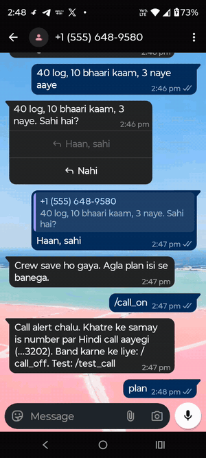</td>
<td width="25%" align="center">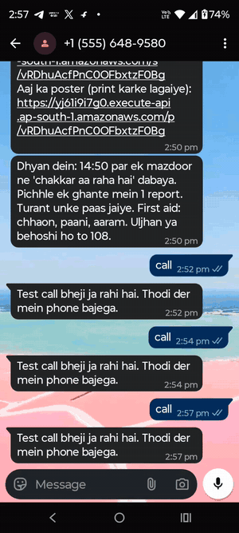<br><sub>the Hindi call</sub></td>
</tr>
<tr>
<td align="center"><br><b>Gurpreet</b><br>worker</td>
<td valign="top">Scans the site QR. No app, no login. Logs a rest break. If he feels dizzy he taps <b>Chakkar aa raha hai</b> and sees fixed first aid. At that moment Ramesh gets a WhatsApp alert and his phone rings with a Hindi call. A printable poster shows the day as a ruler for workers who do not read.</td>
<td align="center">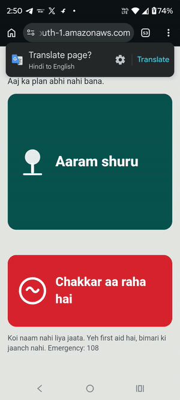</td>
<td align="center">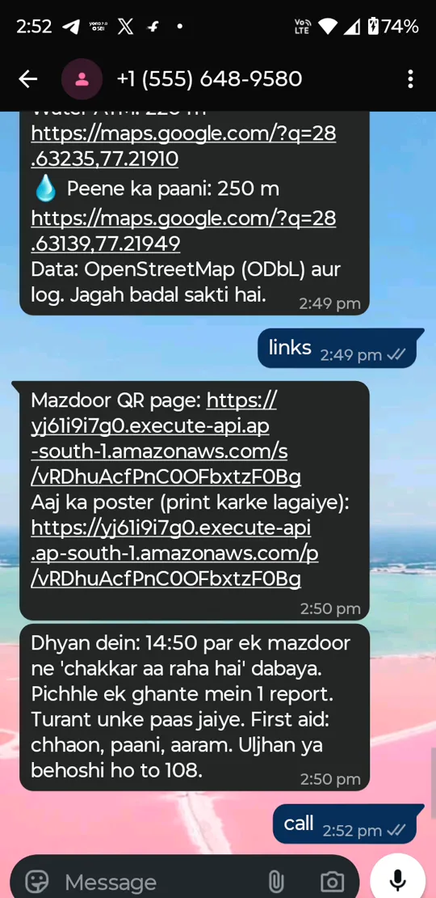<br><sub>the supervisor's alert</sub></td>
</tr>
<tr>
<td align="center"><br><b>Meena</b><br>expecting, with Chotu and Dadi</td>
<td valign="top">Says <i>hi</i>, taps <i>Mere aur parivar ke liye</i>, answers five button questions about the household (counts only, never names) and gets today's plan with stricter limits for the elderly, children, pregnancy and illness, plus better hours for errands and warm-night advice. On dangerous days Dadi gets one Hindi phone call: stay inside 9 to 5, sip water, 108 if unwell.</td>
<td align="center">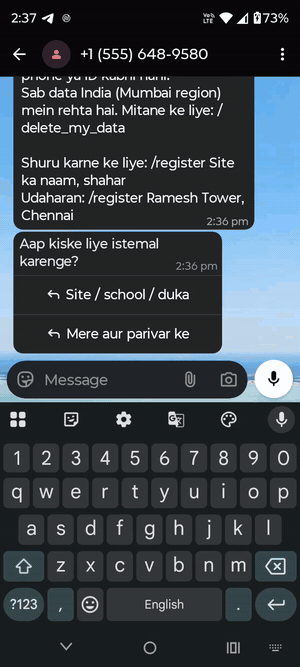</td>
<td align="center">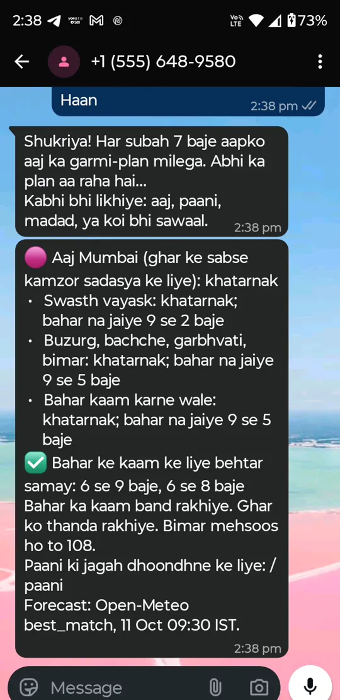<br><sub>today's plan, Mumbai</sub></td>
</tr>
<tr>
<td align="center"><br><b>Lakshmi</b><br>street vendor</td>
<td valign="top">Types <i>paani Connaught Place</i> (or shares a location pin) and gets the nearest drinking water and shade: 190 m away, with a map link, from OpenStreetMap and community reports. Schools, shops and delivery riders register the same way and get their own limits and lines.</td>
<td align="center">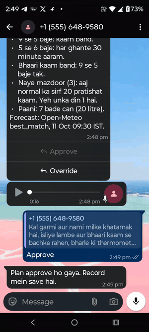</td>
<td align="center">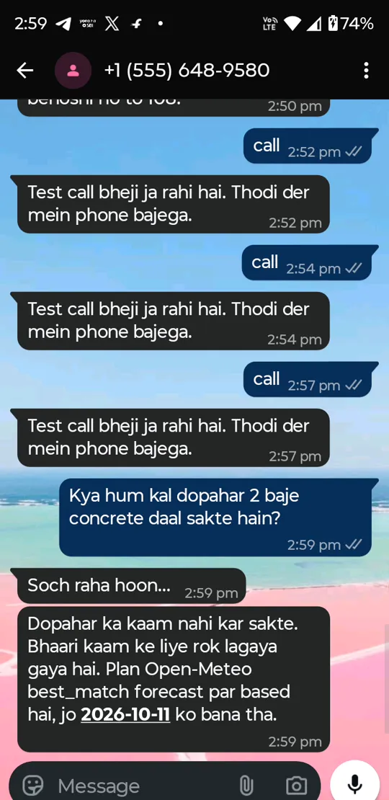<br><sub>ask anything</sub></td>
</tr>
</table>

Everything above, in one table:

| Feature | Who | How |
|---|---|---|
| 7 pm plan with voice note, Approve / Override | Supervisors | Text + Polly voice note; Step Functions waits up to 12 h for the tap; Cedar denies the AI any loosening |
| Re-check at 10:30 and 13:30 | Supervisors | Rebuilt from the newest forecast; alerts only if an hour got stricter; must be acknowledged |
| Ask anything, by text or voice | Supervisors | Bedrock (Nova Pro) with Strands tools; a number check blocks invented numbers; Transcribe for Hindi voice |
| Hindi phone calls | Supervisors, elders | `/call_on`, `/family_call`; fixed Hindi text spoken by Polly, placed by Twilio |
| Worker QR page and poster | Workers | No account; Aaram shuru / Chakkar buttons; fixed first aid; the poster is a day ruler |
| Family mode | Anyone in India | A city or a pin (0.25° tile computed once and shared); 5 button questions; stricter limits for the vulnerable; 07:00 message |
| Water and shade finder | Vendors, riders, everyone | `paani <place>` or a pin; OpenStreetMap + community points, labelled unverified |
| Rain, flood, warm nights | Sites, families | IMD rain categories; GloFAS river signal for Guwahati and Patna; warm-night rule recreated |
| Records and compliance | Contractors, auditors | SHA-256 hash-chained nightly record per site in S3 Object Lock; monthly PDF built only from records |

---

## 3. The Pehra Site Box

<table><tr>
<td width="50%"></td>
<td width="50%" valign="top">

Some sites have no smartphone at all. For them, Pehra is a box: about ₹600 of parts around an ESP32, one per site. It measures the heat workers actually feel, acts on it, and talks to AWS IoT Core. Firmware and wiring: [`devices/sitebox/`](devices/sitebox/) · contract: [`docs/SITEBOX_CONTRACT.md`](docs/SITEBOX_CONTRACT.md).

| Part | What it does |
|---|---|
| DHT22 | air temperature and humidity: the wet-bulb part of WBGT |
| DS18B20 in a matt-black globe | radiant heat from the sun, tin and concrete: the globe part |
| 2 × HC-SR04 sonar | drinking-water tank level (pump, "tank low" with cans needed) and drain level (waterlogging alert + call) |
| OLED + 12-LED ring | four Hindi status lines and the risk colour, kam → khatarnak |
| Buzzer | rest siren at each rest block, stop-work siren in stop hours |
| 2 relays | mist fan from *zyada*; tank pump on below 20%, off at 90% |
| Red SOS button | WhatsApp alert and a Hindi call to the supervisor |

Site WBGT = 0.7·Tnw + 0.2·Tg + 0.1·Ta (Stull wet bulb), compared with the forecast.

</td></tr></table>

| Wokwi ESP32, real firmware | Live 3D twin (Three.js, polls the box state every 3 s) |
|---|---|
| 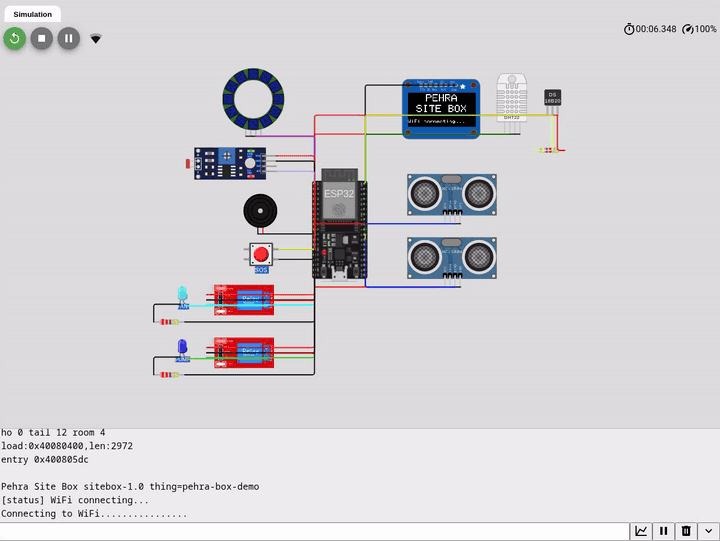 | 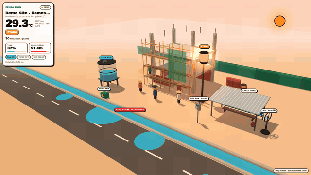 |

**How it talks to AWS.** The box publishes telemetry over MQTT/TLS with its own X.509 certificate to `pehra/box/{thing}/telemetry` (the IoT policy lets a thing publish only to its own topic). An IoT rule (`SELECT *, topic(3) AS box_id`) invokes the Site Box Lambda, which computes WBGT and the level (`heatcore/sitebox.py`), applies the same rest bands as the plans, sends rate-limited alerts, stores the state in DynamoDB and publishes the command back on `pehra/box/{thing}/cmd`. HTTPS `POST /api/box` with a device token is the fallback. `scripts/iot_provision.py` creates the thing, certificate and policy and writes a filled-in sketch.

<table><tr>
<td width="30%" align="center">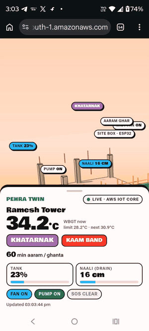</td>
<td width="70%" valign="top"><b>What happened on 11 October.</b> A box was registered from WhatsApp with <code>/device box</code>. Readings published to IoT Core (WBGT 34.2 °C, khatarnak, tank 17%) started the pump and sent two WhatsApp alerts. The SOS button turned the twin red, sent a WhatsApp alert and rang the supervisor's phone in Hindi. The twin page and the SOS clip in the video were recorded live.<br><br> <i>Boondi says: the twin shows exactly what the box sees, nothing more.</i></td>
</tr></table>

---

## 4. How it runs on AWS

<p align="center">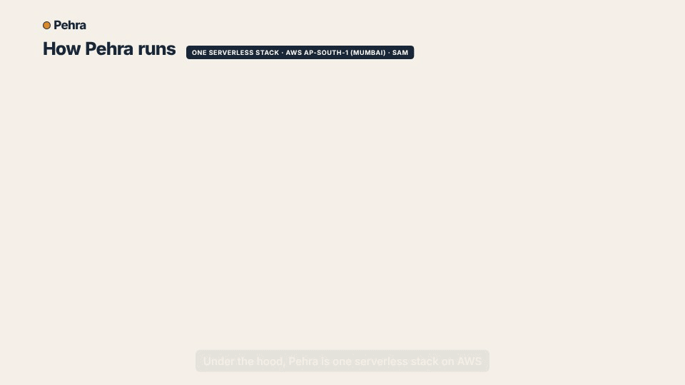</p>
<p align="center"><sub>Static version: <a href="docs/img/architecture.png">architecture.png</a> · Project report with every screenshot and AWS proof: <a href="docs/Pehra_report.pdf">docs/Pehra_report.pdf</a> · Pitch deck: see the submission links</sub></p>

### Every AWS service, and exactly what it does in Pehra

One SAM stack (`template.yaml`, stack `invisible-heat`) in **ap-south-1 (Mumbai)**, so Indian users' data stays in India. Python 3.12 on **arm64 (Graviton)**, with a shared Lambda layer holding `heatcore/`, `ihcommon/`, `agent/`, the Cedar policies and the web pages.

| Service | What Pehra uses it for | Where in the code |
|---|---|---|
| **AWS Lambda** (14 functions, arm64) | `IngestForecast` (forecast → WBGT), `DailyFanout` and `PlanWorker` (one plan per site), `PlanStep` (inside Step Functions), `Sender` (WhatsApp, Telegram, Twilio calls), `WhatsAppWebhook`, `TelegramWebhook`, `Assistant` (AI answers, voice input), `PersonalFanout` (07:00 family plans), `Recheck` (10:30 / 13:30), `NightlyRecord` (23:30), `ReportPdf` (monthly PDF), `PublicWeb` (site, worker QR page, poster, audit, media links), `IotBox` (Site Box state + commands) | `functions/*/app.py` |
| **Amazon EventBridge Scheduler** | Forecast ingest 05:30, 09:30, 17:30 IST; family plans 07:00; site plans 19:00; re-checks 10:30 and 13:30; records 23:30 | `template.yaml` (`ScheduleV2` events) |
| **AWS Step Functions** | One execution per site per day. The plan task uses `waitForTaskToken` and waits up to 12 hours for the supervisor's **Approve / Override** tap; retries and full history built in | `statemachine/daily_plan.asl.json` |
| **Amazon API Gateway** (HTTP API) | WhatsApp and Telegram webhooks (signature-checked, fail closed), the worker QR page and check-ins, the poster, sensor and Site Box HTTPS, the audit page, the 3D twin, `/media` links | `template.yaml` `HttpApi`, `functions/public_web`, `functions/*_webhook` |
| **Amazon SQS** + dead-letter queues | `PlanQueue` fans plans out per site; `OutQueue` rate-limits every outgoing message and call; permanent provider errors are not retried; a DLQ alarm fires on anything stuck | `ihcommon/outbox.py`, `functions/sender` |
| **Amazon DynamoDB** (single table) | Sites, crews, people (household counts only), chat state, check-ins, alerts, Site Boxes (hashed device and view tokens), plan task tokens | `ihcommon/repo.py`, `ihcommon/boxes.py` |
| **Amazon S3** (3 buckets) | **Heat store**: WBGT per city/tile per run (expires after 30 days). **Media**: Polly voice notes, call audio, incoming voice, website videos (presigned links). **Records**: nightly hash-chained records with **Object Lock** (GOVERNANCE, 90 days) | `ihcommon/heatstore.py`, `ihcommon/records.py`, `ihcommon/voice.py` |
| **AWS IoT Core** | Each Site Box is a thing with its own X.509 certificate; the policy lets a thing publish only to `pehra/box/{its name}/telemetry`; a topic rule (`SELECT *, topic(3) AS box_id`) invokes `IotBox`, which publishes the command back on `.../cmd` | `template.yaml` `SiteBoxIotPolicy`, `SiteBoxTelemetryRule`; `scripts/iot_provision.py` |
| **Amazon Bedrock** (Amazon Nova Pro) with **Strands Agents** | Explains plans and answers free questions in Hindi; tools compute every number (coolest window, rest bands, water); a number check (units too) blocks invented figures; fixed fallback text if anything fails | `agent/agent.py`, `agent/tools.py`, `agent/number_check.py` |
| **Cedar** (open source, via `cedarpy`) | Authorization for actions: the AI can never loosen or override a plan; only the site's supervisor can, with a written reason; a device writes only to its own stream; raw worker data stays out of AI tools | `cedar/policies/*.cedar`, `ihcommon/authz.py` |
| **Amazon Polly** (Kajal, neural, hi-IN) | Hindi voice notes for plans and the audio of every phone call (played by Twilio from a short-lived S3 link) | `ihcommon/voice.py`, `ihcommon/voicecall.py` |
| **Amazon Transcribe** (hi-IN) | Crew counts and questions sent as voice notes; low-confidence audio is answered with "please type it" | `ihcommon/transcribe.py` |
| **AWS Systems Manager Parameter Store** | All secrets as SecureString (WhatsApp, Telegram, Twilio, data key); nothing in git or in Lambda environment variables | `scripts/setup_secrets.sh`, `ihcommon/config.py` |
| **Amazon CloudWatch** | Embedded-metric-format metrics (plans sent, calls, water finder, family opt-ins), logs, and alarms for a late forecast and for messages stuck in the DLQ | `ihcommon/log.py`, `template.yaml` alarms |
| **Amazon SNS** + **AWS Budgets** | Alarm emails and an optional $5 budget alert | `template.yaml` `AlarmTopic` |
| **AWS SAM / CloudFormation** | The whole stack in one template, deployed with `sam deploy` | `template.yaml`, `samconfig.toml` |

**Why it costs almost nothing at scale.** WBGT is computed once per city or 0.25° tile, not once per user: a million sites in Mumbai read the same heat file. Everything else runs only when a message, a schedule or a device asks.

**Proof from the account** (CLI output, rendered with [freeze](https://github.com/charmbracelet/freeze); the account id is masked):

| Stack resources | IoT Core: things, rule and endpoint |
|---|---|
| 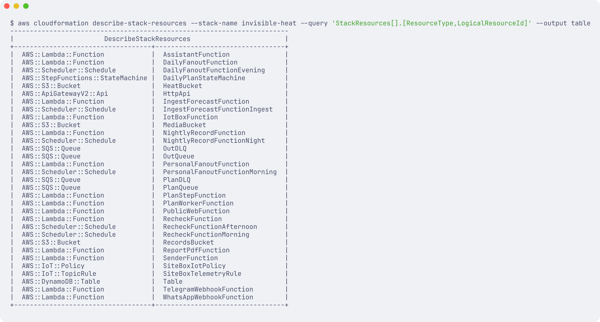 | 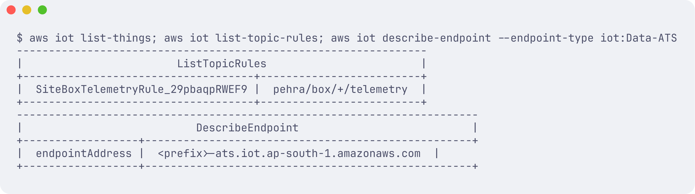 |

| Step Functions executions | S3 Object Lock on the records bucket | Lambda on arm64 with Bedrock, DynamoDB |
|---|---|---|
| 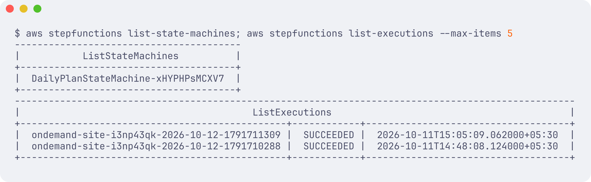 | 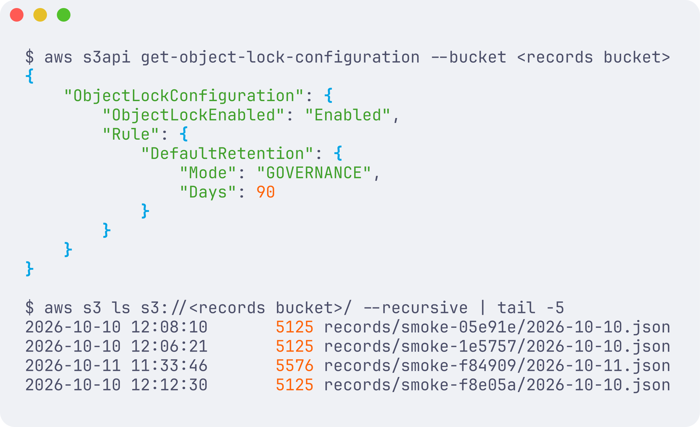 | 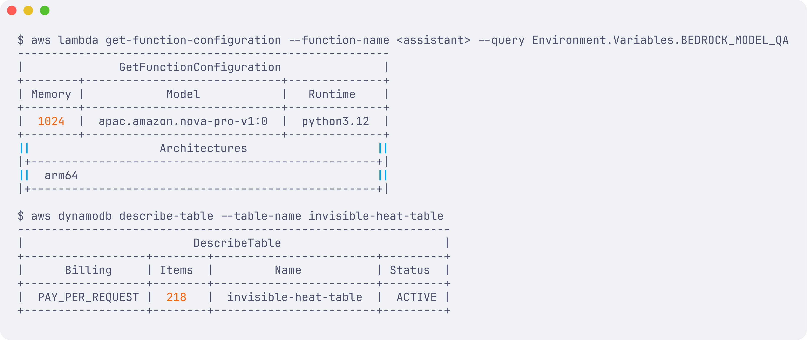 |

**The Hindi calls, from the Twilio log** (11 Oct 2026, numbers masked): six completed calls to the supervisor's phone, 13 to 42 s each, matching the Polly audio lengths.

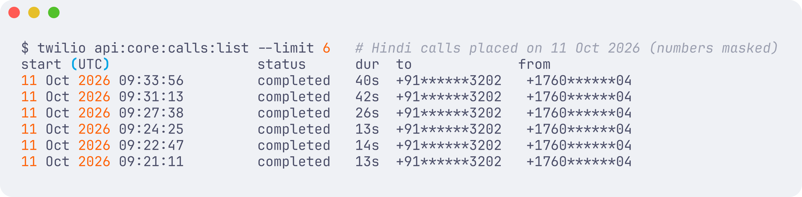

### How the AI is kept honest
1. **Numbers come from code, never from the model.** `heatcore/` is pure Python with no AWS imports; every user-facing number comes from it.
2. **Number check.** Every number in an AI reply must appear in a tool output from the same turn (`agent/number_check.py`), including units (cans, litres). If not, regenerate once, then send the fixed template.
3. **Plan messages** are a short AI intro on top of a fixed template body, so stop times, rest minutes and water never depend on the model.
4. **The AI can never loosen a plan.** Cedar policy (`cedar/policies/plans.cedar`), not the prompt. Only the supervisor can, with a written reason of at least 10 characters.
5. **First aid is fixed text**, routed before any model call. **Fallbacks always exist**: no Bedrock, fixed Hindi text; no Polly, text only.

Full diagram, rationale and failure modes: [`docs/architecture.md`](docs/architecture.md).

---

## 5. Run it

```bash
uv sync --python 3.12
uv run pytest                                   # 246 tests: science, Cedar, agent tools, webhooks, Site Box, e2e
uv run python scripts/kharghar_replay.py
uv run python scripts/run_audit.py              # ~1 min with cache; writes docs/results/audit_summary.json
uv run python scripts/preview_web.py            # the website at http://127.0.0.1:8765
```

Deploy (AWS SAM, ap-south-1):

```bash
./scripts/setup_secrets.sh                      # WhatsApp, Telegram, Twilio secrets into SSM SecureString
make layer && sam build && sam deploy           # samconfig.toml pins the region and the Nova models
uv run python scripts/set_webhook.py            # points the bots at the API
```

Then message the WhatsApp number with `hi`. For a site: `/register Ramesh Tower, Kharghar`, then `40 log, 10 bhaari kaam, 3 naye aaye`, then `plan`. A city outside the 12 pre-computed ones snaps to the nearest one within 60 km. Smoke tests without sending anything: `scripts/smoke_deployed.py`, `scripts/smoke_v2.py`.

Useful scripts: `scripts/iot_provision.py` (an IoT thing + filled sketch), `scripts/rotate_tokens.py` (rotate a site QR token or a box device token), `scripts/video/*` (the demo video pipeline, see below).

---

## 6. Results

| Check | Result |
|---|---|
| WBGT vs OSHA online calculator, 15 Chennai hours | Mean absolute difference **0.21 °C**, max 0.49 °C. `tests/test_heatcore_wbgt.py` |
| NIOSH limits | REL 28.2 °C, RAL 25.0 °C at 300 W, matching the worked example |
| Cedar decisions | All 7 required cases plus 5 more pass; the AI is denied LoosenPlan and OverridePlan |
| Agent test set (40 Hindi/English questions, Nova Pro) | Facts correct **38/40** · invented numbers shipped **0** · correct refusals **9/9**. `docs/results/agent_eval_40.json` |
| Real phone, end to end (11 Oct 2026) | Family mode, water by place name, site + crew + plan + voice note + Approve, worker QR page, chakkar alert + Hindi call, test call, AI question, family call, `/device box` → IoT Core → alerts → live twin → SOS → call, Override with a reason. Every call played the full Hindi message. |
| Site Box through AWS IoT Core | MQTT publish → rule → Lambda → state in DynamoDB → command on the box's `cmd` topic; the twin shows the same state |
| Audit 2021 to 2025, 12 cities | 4,372 invisible heat city-days (shade), 2,327 outside March to June, 90 heavy-rain days, 68 warm nights (minimums) |
| Deployed smoke test | Plan with AI intro and voice note; worker page, poster and audit served; break logged; nightly record in Object Lock (GOVERNANCE, 90 days); hash chain verified |

---

## 7. The demo video

Built in **Remotion** (`video/`): Inter, the brand palette with one saffron accent, spring motion with a tiny overshoot, no glows or crossfades. Order: the problem told fully, then Pehra as four stories on a real phone, then the Site Box, then the architecture drawing itself, then what Pehra does not claim.

- Narration: Amazon Polly (Kajal), `scripts/video/vo.py`; every number from `docs/results/` and the audit page.
- Illustrations: generated with Codex in the brand style (`video/public/gen/`, `web/img/ill-*.webp`). Illustrated people, not real people.
- Phone chapters: one scrcpy recording cut per feature by `scripts/video/phone_cut.py` (owner's number blurred, waits sped up and labelled, each call's audio is the Polly MP3 the call played). Tokens seen on screen were rotated afterwards with `scripts/rotate_tokens.py`.
- Twin footage: `scripts/video/record_twin.mjs` records the live twin page. GIFs in this README come from the same recordings.

```bash
uv run python scripts/video/vo.py
uv run python scripts/video/phone_cut.py
node scripts/video/record_twin.mjs <twin url> out/video/twin.mp4
cd video && npm install && npx remotion render src/index.ts Pehra out/pehra_brand.mp4
```

---

## 8. Limits (read before quoting anything)

- The weather grid is 11 to 25 km wide, so a site-level plan rests on district-scale weather. Tin roofs, concrete and lack of shade make real sites hotter; the Site Box exists for that.
- There is no open Indian heat-illness outcome data, so **we make no claim of lives saved**. The design aim is to reduce exposure. Pehra is not medical advice and not an official weather warning.
- The IMD heatwave rule is recreated on one grid cell per city from ERA5; it is not IMD's declaration record. The Kharghar replay uses reanalysis, not the forecast available that evening.
- The work-rest bands are this project's own planning rule on top of NIOSH limits, with a +1.0 °C margin (+0.5 °C when the forecast is stale).
- WhatsApp uses Meta's test number (pre-approved recipients only); calls use a Twilio trial that plays a short notice first. In the phone recording the Site Box readings were published to IoT Core from a laptop script; the firmware itself is shown running in Wokwi.
- The compliance PDF uses a labelled sample month. The re-check demo uses a labelled "+1.5 °C SIMULATED" forecast.

## Privacy
Sites store a name, a city, crew counts and an encrypted chat id; never worker names, phones or ids. Families store a place and household counts. `/delete_my_data` removes everything except locked daily records, which expire on their own. Cedar keeps raw worker data out of AI tools.

## Closest existing tool
SHRAM (heat-stress guidance for workers) gives generic advice; Pehra gives a per-site, per-hour plan with an approval record, a worker page with no app, a family mode, a water finder and a device channel.

## What's next
WhatsApp scheduled templates, an Indian caller id, Tamil, Bengali and Odia voices, ECMWF ensembles for probabilities, labour-department dashboards, insurance triggers, pilots with SEWA-type groups.

## Credits and licences
Open-Meteo (CC BY 4.0) for forecast, ERA5 archive, GloFAS and geocoding · thermofeel (Apache-2.0) for Liljegren WBGT · NIOSH 2016 criteria · © OpenStreetMap contributors (ODbL) · Wokwi · Strands Agents SDK, Cedar via cedarpy, AWS SAM · Inter and Noto Sans Devanagari (OFL). Brand kit: [`docs/BRAND.md`](docs/BRAND.md).

## AI tools used
Claude Code (Anthropic) built most of the code, tests, docs and the video under the team's direction. Codex generated the illustrations and helped with earlier UI drafts. Amazon Nova Pro on Bedrock answers questions at runtime; Polly and Transcribe handle voice.

## Team
Team Mavricks: Arpit Singh, Pradyuman Sharma.
