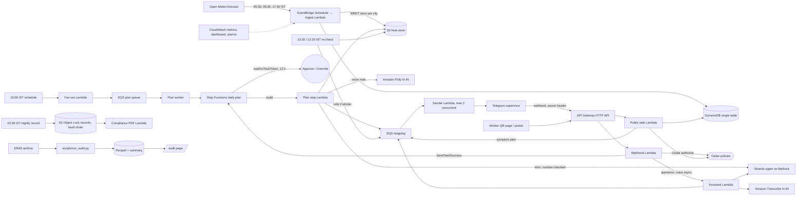

# Architecture

One SAM stack in `ap-south-1` (Mumbai). Everything is serverless and idle when unused.

## Services and why

| Service | Why it is there |
|---|---|
| EventBridge Scheduler + Lambda | Fetch the forecast and compute WBGT once per city three times a day; trigger the 19:00 plan, 10:30/13:30 re-checks and the 23:30 record. |
| Step Functions (Standard) | The plan waits up to 12 hours for Approve/Override (`waitForTaskToken`), retries failed steps and keeps a visible history of every plan. |
| Strands Agents SDK + Amazon Bedrock | AWS's open-source agent framework. The model explains and answers; deterministic tools do every calculation. India geo inference profiles keep processing in India. |
| Cedar (open source) | Enforces "the AI can never loosen a plan" and "raw worker check-ins stay with the supervisor" outside the prompt. |
| Amazon Polly (Kajal, neural, hi-IN) | Hindi voice notes in OGG/Opus, which Telegram plays as a voice message. |
| Amazon Transcribe (hi-IN) | Supervisor voice notes such as "40 log, 10 bhaari kaam, 3 naye aaye". |
| API Gateway HTTP API | Telegram webhook, worker QR page, poster, check-in API, audit and model-card pages. |
| DynamoDB (on-demand, TTL) | Sites, crews, plans, overrides, alerts, check-ins, idempotency keys, rate limits. |
| S3 | Heat store (one object per city per run), voice notes, and Object Lock daily records. |
| SQS + DLQs | Plan fan-out (idempotent per site and date) and a rate-limited outgoing message queue. |
| SSM Parameter Store (SecureString) | Telegram token, webhook secret and data key. Free tier. |
| CloudWatch | Structured logs with hashed ids, metrics via EMF, dashboard, forecast-late and DLQ alarms. |
| SAM (open source) | One-command build and deploy. |

## Scale design

- **Compute once, look up many.** Heat is computed per city per forecast run. A site plan is a lookup, so a million sites cost the same weather work as one.
- **Fan-out.** The 19:00 schedule puts one message per site on SQS. Workers start one Step Functions execution per site and date; the execution name and a DynamoDB conditional write make re-runs idempotent.
- **Messaging.** All outgoing messages pass through one queue drained by a sender with bounded concurrency, which respects Telegram's rate limits and retries on HTTP 429.
- **Multi-tenant ready.** `tenant_id` is stored on every site and used by Cedar for contractor access.

## Failure modes

| Failure | What the supervisor sees | Recovery |
|---|---|---|
| Forecast run is late | Plan marked "purana forecast", +0.5 °C stricter | Alarm fires; next run replaces it |
| Bedrock down or slow | Same plan as fixed Hindi text, no AI intro | Template fallback; agent resumes later |
| Polly fails | Text only | Voice skipped for that plan |
| Telegram rejects a message | Arrives a little later | Stays in SQS and retries; DLQ and alarm after 5 failures |
| AI writes a number not in any tool output | Never sees it | Regenerated once, then replaced by the template |
| Supervisor does not respond | Plan stays as sent | After 12 h the state machine records "no response" |
