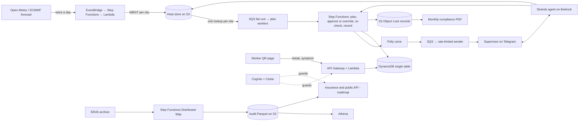

# 07 · AWS architecture

Region: `ap-south-1` (Mumbai) for application data. ECMWF open data lives in `eu-central-1`; ERA5 (Open-Meteo copy) in `us-west-2`. Cross-region reads are fine; do not copy personal data out of India.

Infrastructure as code: **AWS SAM** (`template.yaml`). One command deploys everything: `sam build && sam deploy --guided` first time, then `sam deploy`.

## Diagram

## Services and why (state this in the README and video)

| Service | Why it's there |
|---|---|
| EventBridge Scheduler + Lambda | Fetch forecast and compute heat once, twice a day. Also triggers the 19:00 plan, 10:30 re-check and nightly record. |
| Step Functions | The daily plan flow waits hours for approval (`waitForTaskToken`), retries on failure, and keeps visible history. Distributed Map runs the audit in parallel. |
| Strands Agents SDK + Amazon Bedrock | AWS's open-source agent framework. The model explains and answers; tools do the maths. |
| Amazon Polly | Hindi voice notes (voice for `hi-IN`; verify availability, e.g. "Kajal"). |
| Amazon Transcribe | Hindi voice in (crew roster, questions). |
| API Gateway + Lambda | Telegram webhook; worker QR page API; future public API. |
| DynamoDB | Single table for sites, crews, plans, check-ins; TTL on old items. |
| S3 (+ Object Lock) | Heat store, audit data, posters, tamper-proof daily records. |
| Athena | Queries over the audit Parquet. |
| SQS | Fan-out of plan generation; rate-limited outgoing messages; dead-letter queues. |
| Cedar (open source) | Enforces "AI can't loosen limits" and privacy rules. |
| SAM (open source) | One-command deploy. |
| Secrets Manager / SSM | Telegram bot token. |
| CloudWatch | Logs, dashboard, alarm if forecast late. |
| Cognito | Contractor logins (Roadmap for the full console; Weekend can use Telegram identity + a signed site token). |

## Weekend simplifications (allowed)

- Telegram identity is the supervisor identity. The site is registered through a `/register` command that stores `chat_id` hashed.
- Worker QR page is public but uses an unguessable `site_token` and rate-limits.
- One forecast provider (Open-Meteo) for the live demo; ECMWF on S3 documented as upgrade.
- Single AWS account, single environment (`prod`), one stack.

## DynamoDB single-table design

Table `InvisibleHeat`, on-demand billing. Keys `PK`, `SK`; GSI1 `GSI1PK`, `GSI1SK`. TTL attribute `ttl`.

| Entity | PK | SK | Attributes |
|---|---|---|---|
| Site | `SITE#{site_id}` | `META` | `name`, `city`, `lat`, `lon`, `owner_chat_hash`, `site_token`, `tenant_id` |
| Crew snapshot | `SITE#{site_id}` | `CREW#{date}` | `headcount`, `heavy_count`, `new_count`, `new_day`, `returning_count` |
| Plan | `SITE#{site_id}` | `PLAN#{date}` | `plan_json`, `forecast_run`, `generated_at`, `status` (`sent`/`approved`/`overridden`), `plan_hash` |
| Override | `SITE#{site_id}` | `OVR#{date}#{ts}` | `direction` (`stricter`/`looser`), `reason`, `actor_role` |
| Alert/ack | `SITE#{site_id}` | `ALERT#{date}#{ts}` | `kind`, `acked_at` |
| Check-in | `SITE#{site_id}` | `CHK#{date}#{ts}` | `type` (`break_start`/`break_end`/`symptom`), `device_token_hash` |
| Heat cache pointer | `HEAT#{city}` | `RUN#{run_id}` | `s3_key`, `issued_at` |
| Idempotency | `IDEM#{site_id}#{date}` | `PLAN` | `done_at`, `ttl` |

Use conditional writes (`attribute_not_exists`) for idempotency.

## Plan flow (Step Functions)

1. `LoadSiteAndHeat` → read site, crew, cached heat for the city.
2. `BuildPlan` → call `heatcore` (deterministic).
3. `RenderMessage` → Strands agent turns structured plan into Hindi text (with number check); on failure use template.
4. `Synthesize` → Polly voice note to S3; on failure skip voice.
5. `Send` → put message on outgoing SQS.
6. `WaitForApproval` → `waitForTaskToken` with timeout (e.g. 4 hours); token stored with the plan.
7. On button press (API Gateway → Lambda) → `SendTaskSuccess` with `approve` or `override` payload; Cedar checks the override.
8. `Recheck` → separate scheduled run; compares and may alert.
9. `NightlyRecord` → compile the day, hash, write to Object Lock bucket.

## Scale design (explain; implement lightly)

- **Compute once, look up many.** Heat is computed for a fixed set of cities/tiles per forecast run; each site is a lookup by nearest tile. A million sites cost the same to compute as one.
- **Fan-out:** EventBridge → SQS → plan workers (Lambda, idempotent per `site_id + date`).
- **Messaging:** a separate sender Lambda drains the outgoing queue under Telegram's rate limits; retries; dead-letter queue.
- **State:** DynamoDB single table, TTL on old items.
- **Records:** S3 Object Lock + Athena.
- **Agent cost:** small model for routine message rendering, larger only for questions; prompt caching if available.
- **Audit:** Step Functions Distributed Map over ERA5 (thousands of parallel jobs).
- **Multi-tenant:** `tenant_id` in every key (design now; one tenant live).

## Well-Architected, one line per pillar

| Pillar | What to show |
|---|---|
| Operational excellence | SAM template, GitHub Actions deploy, CloudWatch dashboard, alarm if forecast is late |
| Security | Least-privilege IAM, secrets in Secrets Manager, encryption at rest, headcounts only, data in ap-south-1 (DPDP-aware) |
| Reliability | Two forecast sources (stretch), dead-letter queues, stale-data flag, template fallback, idempotent plans |
| Performance | Precomputed heat store, DynamoDB lookups, Lambda arm64 (Graviton) |
| Sustainability | Compute once for the country, Graviton, nothing running idle |

(The cost pillar is intentionally not detailed; do not publish ₹-per-site claims.)

## Failure-mode table (include in README)

| Failure | What the supervisor sees | Recovery |
|---|---|---|
| Forecast run is late | Yesterday's plan for today marked "older forecast" | Alarm fires; next run replaces it |
| Bedrock down or slow | Same plan as fixed Hindi text, no chat | Template fallback; agent resumes later |
| Polly fails | Text only | Voice skipped; retried next run |
| Telegram rejects a message | Arrives a little later | Stays in SQS, retries; DLQ after repeated failures |
| Agent writes a number not in any tool output | Never sees it | Regenerated, then replaced by template |
| Supervisor doesn't acknowledge a red day | (Weekend) nothing extra; (Roadmap) repeat + contractor alert | Roadmap F-13 |

## IAM and networking

- One role per Lambda with only the actions it needs (`dynamodb:GetItem/PutItem/Query` on the table ARN, `s3:PutObject` on specific prefixes, `polly:SynthesizeSpeech`, `bedrock:InvokeModel` on the chosen model ARN, `states:SendTaskSuccess`).
- No VPC needed for the weekend build.
- S3 buckets: block public access; Object Lock enabled at creation (cannot be added later); SSE-S3 or KMS.

## Observability

- Structured JSON logs with `site_id_hash`, never chat IDs or names.
- CloudWatch dashboard: plans sent, approvals, overrides, fallbacks used, number-check failures, forecast age.
- Alarm: forecast age > 12 hours.
